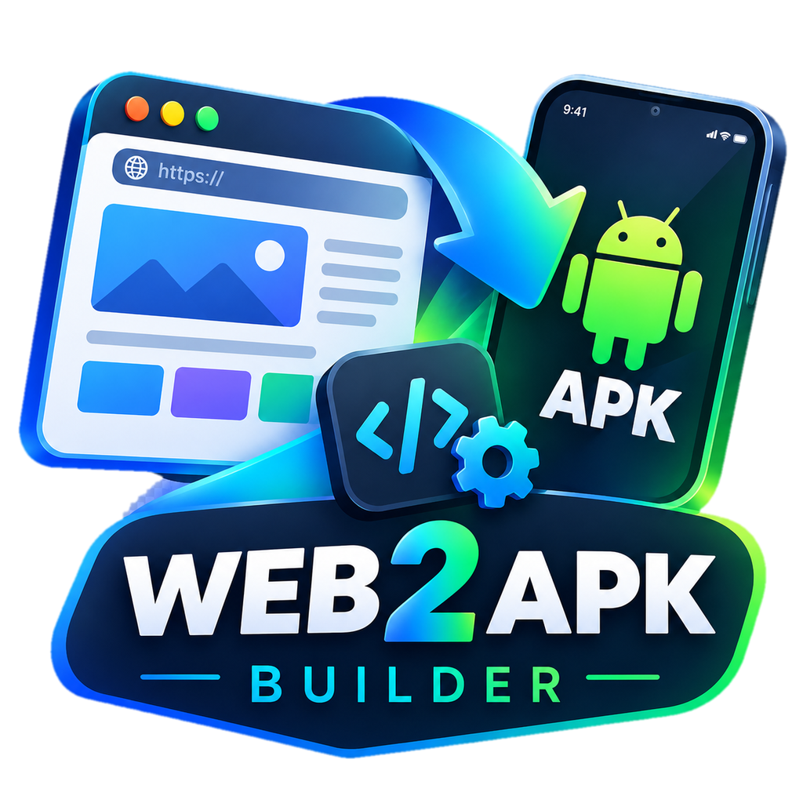

<p align="center">
  
</p>

# Web2APK Builder

Android app that turns a website (URL) into an installable APK, entirely on the phone, with no PC needed. For personal use (not for Google Play).

## Status

**v0.15**: URL mode and ZIP mode work end to end; the signing key can be backed up and restored; built apps can keep sending GPS with the screen off (background location bridge). The Builder UI follows the phone language (English, Russian, Ukrainian, German). Enter a name and URL (or choose a ZIP with the site), optionally pick an icon (otherwise it is taken from the site), choose the screen mode and rotation, tap **Build APK**, then **Install**.

## How it works

1. The builder bundles a prebuilt WebView "template" APK in its assets.
2. On build, it repacks the template:
   - writes the site name, URL, screen mode and rotation into `assets/config.json`;
   - edits the compiled binary `AndroidManifest.xml` (package name and app label);
   - replaces the launcher icon (adaptive icon: the picture is cropped to a square, its edge color becomes the background).
3. The APK is signed on the device (apksig, RSA-2048 key stored in the app, v2 + v3 schemes).
4. The signed APK is saved to Downloads and can be installed right from the app.

Each URL gets its own stable package name (`com.web2apk.app.a<hash of URL>`), so rebuilding the same URL updates the app, while a different URL installs as a separate app.

### ZIP mode (offline sites)

Choose a ZIP whose root contains `index.html` (a single top-level folder is unwrapped automatically). The Builder packs all files into the APK under `assets/site/`, and the template serves them from the virtual origin `https://appassets.androidplatform.net/` (own request interceptor, no extra libraries; supports Range requests for audio/video and a single-page-app fallback to `index.html`). The app then works without internet. While a ZIP is loaded the URL field is disabled; **Reset** returns to URL mode. The package name comes from the app name, so rebuilding with the same name updates the app.

The icon is searched inside the ZIP the same way as for a URL (`manifest.json`, `apple-touch-icon`, `<link rel="icon">`, common file names).

What ZIP mode cannot do: server code. Serverless functions (`/api/...`), databases and secret keys stay on the server, so sites that depend on them (for example Fahrzeit) should use URL mode. Inside the app, data such as `localStorage` belongs to the virtual origin and is not shared with the real site or the browser.

### Signing key backup

Since v0.14 the signing key is a normal RSA-2048 key kept in the app's private storage (`signing.p12`), excluded from cloud backups. **Back up key** asks for a password (at least 6 characters) and then opens the system file picker, where you choose the destination: Downloads, Google Drive, MEGA or any other storage app installed on the phone (no accounts or API keys are handled by the Builder). The file is `web2apk_key_backup.zip`. **Restore key** opens the same picker (cloud apps included) and replaces the current key with the one from such a file, so apps can be updated after reinstalling the Builder or on a new phone.

Migration: the first build after updating from an older version creates the new key and signs a rotation lineage with the old AndroidKeyStore key, so apps built earlier still update in place (Android 9+). The lineage is part of the backup. While the old key still exists on the phone, it signs together with the new one (apksig requires the oldest signer first); on a new phone or after reinstalling the Builder only the new key is used, which is enough for fresh installs and for apps already updated to the new key. If the lineage cannot be created, the old key keeps being used and backup is unavailable.

### Icon

Priority: icon picked manually, then icon found on the site, then the default icon.
The site icon is looked up in this order: `manifest.json` icons, `apple-touch-icon`, `<link rel="icon">` (PNG), then `/apple-touch-icon.png` and `/favicon.ico`. SVG icons are skipped.

## Features of the generated apps

- WebView with JavaScript, DOM storage and geolocation
- Runtime permissions for location, camera and microphone
- File chooser for uploads
- Links within the same site stay in the app; other links open in the browser
- HTTPS only
- Back button navigates the WebView history
- Status bar and navigation bar automatically match the page colors (follows theme changes)
- Per-app screen mode: normal bars, no status bar, or fullscreen
- Per-app rotation: auto, portrait only, or landscape only
- Fullscreen video support
- Background location for the site (see below)
- ZIP mode: the site is packed into the APK and works offline (service workers are served from the package too)
- Sites see the app as an installed PWA (display-mode: standalone), so their own "install app" banners hide; the user agent ends with `Web2APK`. The script runs at document start (before the page's own scripts) through `androidx.webkit` document-start scripts, with the later injection as a fallback
- Launcher icon fills the whole icon shape (adaptive icon, background color taken from the picture edges)

### Background location (template 1.7+)

A web page gets no GPS once the screen is off or another app is in front. Built apps therefore offer the site a small JavaScript bridge to a native foreground service (`LocationService`) that keeps receiving positions and sends each one directly to a URL chosen by the site, so it does not matter that the WebView sleeps.

```js
if (window.W2A && W2A.bgLocationAvailable && W2A.bgLocationAvailable()) {
  W2A.bgLocationStart(JSON.stringify({
    url: 'https://example-default-rtdb.firebaseio.com/sessions/ABC.json', // https only
    extra: { active: true },       // merged into every update
    stop:  { active: false },      // sent once when stopped from the notification
    intervalMs: 5000,
    title: 'My app', text: 'Sharing location'
  }));
}
W2A.bgLocationRunning();  // true while the service runs
W2A.bgLocationStop();
W2A.bgBatterySettings();  // opens "ignore battery optimization" for this app
```

Each update is `POST` with `X-HTTP-Method-Override: PATCH` and the body `{...extra, lat, lng, ts, acc, speed, native: true}` (Firebase Realtime Database REST accepts this). Only the newest position is sent if the network is slow. The service shows an ongoing notification with a **Stop** button, holds a partial wake lock (max 12 h) and asks once to be excluded from battery optimization. Only pages of the wrapped site can start it. On HyperOS/MIUI also set the app's battery saver to "No restrictions".

## Stack

- Kotlin, Jetpack Compose (builder app)
- Java, plain Activity + WebView (template, only `androidx.webkit` for document-start scripts)
- `com.android.tools.build:apksig` for signing
- minSdk 26

## Project layout

- `app/` — the Builder app
  - `apk/` — `ApkBuilder`, `AxmlEditor`, `ApkSign`, `IconMaker`, `IconFetcher`, `Installer`
  - `importer/` — ZIP import
  - `apk/LocalIcon` — icon search inside an imported ZIP
  - `assets/template.apk` — prebuilt unsigned template
- `template/` — source of the WebView template app
  - `assets/bars.js` — script that detects page colors for the system bars
  - `assets/early.js` — script that makes sites treat the app as installed

### Rebuilding the template

After any change in `template/`:

```
.\gradlew.bat :template:assembleRelease
```

Copy `template/build/outputs/apk/release/template-release-unsigned.apk` to `app/src/main/assets/template.apk`.

## Roadmap

| Version | Content | Status |
|---------|---------|--------|
| v0.1 | Project skeleton | done |
| v0.2 | ZIP import | done |
| v0.3 | WebView template, on-device build and signing (URL mode) | done |
| v0.4 | Permissions, in-app install | done |
| v0.5 | App name and unique package per app | done |
| v0.6 | Custom launcher icon | done |
| v0.7 | Icon fetched from the site | done |
| v0.8 | System bar colors, screen modes, rotation lock, fullscreen video | done |
| v0.9 | Builder icon, UI translations (en, ru, uk, de) | done |
| v0.10 | Full-bleed adaptive icons for built apps | done |
| v0.11 | Sites treat built apps as installed (no install banners) | done |
| v0.12 | ZIP mode (offline sites served from the APK) | done |
| v0.13 | Background location bridge for sites (foreground service, works with the screen off) | done |
| v0.14 | Signing key backup / restore (password-protected file, saved anywhere via the system picker) | done |
| v0.15 | Install-detection script runs before the page's scripts (template 1.8, `androidx.webkit`); the manifest editor also renames package-based names added by libraries | done |
| v1.0 | Release | planned |

## Known limitations

- If the Builder is uninstalled or the phone is changed without a key backup, apps built earlier can no longer be updated in place. Back up the key after the first build.
- Apps signed with the pre-0.14 key are updated through a key-rotation lineage, which needs Android 9 or newer.
- OAuth and external login flows are not handled yet.
- ZIP mode has no server side: `/api/...` calls and secrets must stay on a real server (use URL mode for such sites).
- On Android 8–9 the APK is saved to the app's own Downloads folder instead of the public one.
